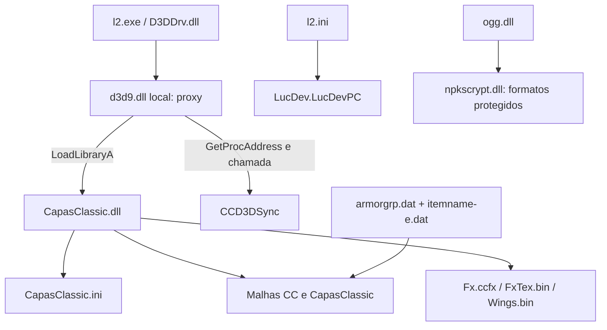

# Auditoria das capas — cliente de referência Interlude

Análise estática dos 44 volumes enviados, concluída em 12/11/2026. Nenhum executável ou DLL do cliente foi executado. Os arquivos originais foram preservados. Este relatório descreve o que existe na **system fornecida**; não certifica compatibilidade com outro cliente nem substitui um teste dentro do jogo.

## Resultado principal

O resultado visual depende de um conjunto: **malhas específicas para raça/sexo, texturas e materiais, associação em armorgrp.dat, correções de encaixe, efeitos e um motor nativo de animação/simulação em CapasClassic.dll**. Não é apenas uma textura ajustada.

LucDev participa do cliente, inclusive como controlador padrão do jogador. Entretanto, a evidência mais direta do mecanismo das capas está na família **CapasClassic/CC** e na ligação com **d3d9.dll**. O nome de um arquivo não comprova autoria de todos os componentes.

## Escopo e verificações

- 297 arquivos extraídos; CRC de todos conferido durante a extração, com SHA-256 registrado no inventário.
- 44 arquivos PE examinados por cabeçalhos, importações, exportações, seções e strings.
- 158 pacotes `.u`: 145 com tabelas Unreal legíveis; 13 protegidos ou de formato não suportado.
- 69 de 70 arquivos de dados/configuração criptografados decodificados. `servername-cn.dat` falhou na descompressão e não foi usado como evidência das capas.
- 2.990 buffers de texto de scripts recuperados dos pacotes legíveis. São fontes preservadas, não uma decompilação completa de bytecode.
- 100 pacotes selecionados pela família de nomes de capas: 1.423 exportações SkeletalMesh e 628 texturas RGBA8 extraídas.
- Mais 32 texturas recuperadas de CapasClassicFxTex.bin: **660 PNGs**, correspondentes a **132 arquivos distintos** após deduplicação exata por SHA-256.
- 25 registros de capas customizadas identificados no armorgrp.dat e cruzados com itemname-e.dat. Os cabeçalhos foram lidos até body_part; as referências de modelos/materiais posteriores foram extraídas como strings, sem afirmar decodificação integral de toda a estrutura por raça.

## 1. Carregamento e renderização



O vínculo d3d9 → CapasClassic foi confirmado por instruções: em 0x100022B9 há carregamento de CapasClassic.dll; em 0x100022CF/0x100022D5 aparece a resolução de `CCD3DSync`, cujo ponteiro é guardado em 0x10021A78 e chamado em 0x100014DF. São endereços virtuais preferenciais do arquivo analisado, sujeitos a realocação.

O proxy contém classes ProxyDirect3D9/ProxyDirect3DDevice9 e exporta Direct3DCreate9, Direct3DCreate9Ex e HangGetPresentAgeMs. Também cita L2modEx.dll, iPerfect.dll e clmods.dll, ausentes no pacote; uma referência opcional não demonstra dependência obrigatória das capas.

CapasClassic.dll exporta `CapasClassic_Init`, `CCD3DSync`, `h5_advance`, `h5_interpolate`, `h5_render_positions`, `h5_render_positions_alpha`, `h5_reset`, `h5_step` e `h5_validate`. Os nomes mostram uma interface de simulação/interpolação; o prefixo h5 sozinho não comprova origem do código em outra crônica.

Há referências a carregamento de objetos Unreal, malhas, texturas, animações, renderização, UpdateAnimation, LoadMap, GPU skinning e LOD. Essas referências descrevem os pontos de integração; não provam que cada caminho esteve ativo numa sessão específica.

**Integridade da DLL:** SHA-256 `20250ed27749bc3e5efee5f307dce3590c982d21d14b3bbbae1e4c747919f3d0`, igual ao arquivo CapasClassic.sha256 enviado.

A DLL contém uma etapa de licença indicada por mensagens de inicialização e importação BCryptVerifySignature. Sua portabilidade para outro cliente não deve ser presumida. A análise não alterou nem contornou essa etapa.

## 2. Ajustes concretos de encaixe

CapasClassicBody.u contém 28 malhas: DynCloth e DynCover para 14 combinações de raça/sexo. CapasClassicCloth.u contém uma malha adicional FFighter_DynCloth. A DLL referencia uma combinação específica para a humana fighter:

- pano: `CapasClassicCloth.FFighter_DynCloth`;
- cobertura: `CapasClassicBody.FFighter_DynCover`.

O texto de importação preservado da cobertura feminina fighter contém **ORIGIN Z=26.5 e YAW=192**. É uma evidência concreta de correção de encaixe no próprio recurso, além da posição do item no inventário. Esses valores pertencem à importação dessa malha; não devem ser aplicados indiscriminadamente a outras capas.

Para as demais combinações aparecem famílias CCMFighter, CCMElf, CCFElf, CCMDarkElf, CCFDarkElf, CCMOrc, CCFOrc, CCMDwarf, CCFDwarf, CCMMagic, CCFMagic, CCMShaman e CCFShaman, com DynCloth/DynCover.

CCDragonBody.u contém 56 malhas, correspondentes a 14 combinações × quatro dragões. CCWingBody.u contém 14 malhas. Outros pacotes CCEss/CCEssence/Festival fornecem variações visuais e recursos por corpo.

### Encaixe dos efeitos no script CCSiegeFxL

O script recuperado de CCFxEmitL.u usa `Owner.AttachToBone(self, 'bip01_spine2')`, deslocamentos por corpo e escala específica do efeito:

| Corpo | Offset X | Offset Y | Offset Z | Escala base |
|---|---:|---:|---:|---:|
| FDarkElf | 4.71 | 6.20 | 0 | 0.891 |
| FDwarf | 4.87 | 4.87 | 0 | 0.677 |
| FElf | 5.31 | 5.70 | 0 | 0.913 |
| FFighter | 5.84 | 5.51 | 0 | 0.953 |
| FMagic | 4.97 | 5.32 | 0 | 0.841 |
| FOrc | 8.36 | 7.35 | 0 | 0.956 |
| FShaman | 6.19 | 5.98 | 0 | 0.993 |
| MDarkElf | 6.35 | 6.54 | 0 | 0.933 |
| MDwarf | 8.20 | 9.49 | 0 | 0.885 |
| MElf | 5.73 | 6.79 | 0 | 0.933 |
| MFighter | 5.00 | 8.50 | 0 | 1.000 |
| MMagic | 5.52 | 5.78 | 0 | 0.909 |
| MOrc | 10.07 | 12.01 | 0 | 1.220 |
| MShaman | 8.04 | 6.65 | 0 | 0.964 |

Esse ator aplica `SetSizeScale(Sc*1.4)`, rotação relativa Pitch=0/Roll=-16383 e calibração de yaw por sondagens. **A tabela é desse efeito auxiliar, não uma escala universal do tecido.** Há métodos compilados correspondentes no pacote, mas o cliente também dispõe de renderização nativa direta. A existência do script não prova que essa rota seja a escolhida pelo modo ativo.

## 3. Configuração efetivamente fornecida

Trechos de CapasClassic.ini:

```ini
[Capa]
fx_desenho_direto=1
fx_remotos=0
pano_suave=1
pano_vento=0
pano_evento_anim=1
pano_sem_reset=1
pano_chao_parado=1
pano_amortecimento=0.88
efeito_montado_oculto=0
efeito_montado_seguir=1
ground=2.0
mount_stiffness=0.55
mount_wind_cap=33
strider_radius=11
strider_length=30
strider_drop=9
strider_forward=6
mount_stiffness_slow=0.75
stress_fx=0
stress_fx_segundos=120
[Efeitos]
beam_trail=0
[BrocheAnim]
FxKgElmo1=24
FxGdRaid=24
ms=85
[EfeitoCapa]
FxCobweb=14
FxGdGrow=14
[BrochePropria]
FxGdGrow=1
```

Os nomes e os leitores nativos sustentam que há tratamento de suavidade, amortecimento, estado montado e efeitos. `fx_desenho_direto` é validado no código como valor entre 0 e 2; o cliente enviado usa 1. O significado completo de cada combinação não foi comprovado por execução. `fx_remotos=0` merece atenção ao comparar a aparência no próprio personagem e em outros jogadores, sem presumir pelo nome quais elementos são ocultados.

O cloak.int também contém parâmetros de tecido Cotton/Hemp: rigidez estrutural 4, amortecimento 0.6, rigidez de flexão 2.4/amortecimento 0.8, gravidade Z=-0.2 e colisão. São outra camada do cliente e não explicam isoladamente as adaptações customizadas.

## 4. Arquivos de efeitos e animação

| Arquivo | Estrutura confirmada | Conteúdo |
|---|---|---|
| CapasClassicFx.ccfx | CCFX, versão 2 | 12 grupos A–L, 82 emissores no total |
| CapasClassicFxTex.bin | CCTX, versão 1 | 32 imagens; nomes de 64 bytes, largura, altura e pixels de 32 bits |
| CapasClassicWings.bin | CCWG, versão 1 | 70 quadros × 94 vértices × XYZ float |

Wings.bin tem exatamente 78.976 bytes, compatível com cabeçalho de 16 bytes e todos os quadros. FxTex.bin foi consumido integralmente pelo leitor, sem sobra. O payload variável de todos os atributos dos 82 emissores não foi integralmente decodificado; não o apresentamos como código-fonte recuperado.

As texturas exportadas são material de consulta. Não devem ser colocadas como PNG diretamente no lugar de pacotes .u/.utx. A exportação não reconstrói malhas PSK, pesos, materiais completos ou o compilador original.

## 5. IDs, modelos e materiais

O arquivo **mapa_itens_capas.csv** contém as 25 associações reais, com referências completas e ícones. Exemplos:

| ID | Nome no cliente | Família do modelo |
|---:|---|---|
| 31307 / 31308 | Olympiad's Red / Blue Cloak | CCFxOlyGCloak / CCFxOlySCloak |
| 31310 / 31311 | Cloak of Darkness / Light | CCFxSiegeBlkCloak / CCFxSiegeWhtCloak |
| 31346 / 31347 | Santa / Halloween | CCFxXmasCloak / CCFxHalloCloak |
| 31380 | Crimson Wings | CCRedRanker |
| 31381 | Festival Pearl White | ClassicCloaks |
| 31382 | Draconic | CCDraconicCloak |
| 31383 | Vesper | CCVesperCloak |
| 31384 | Elegia | CCElegiaCloak |
| 31385 | Vesper's | CCVorpalCloak |
| 31386 | Moirai | CCMoiraiCloak |
| 31387–31391 | Blackbird, Protection, Alien, Royal Guard, Slayer | CCFxBBLineage / BTGuard / DMStranger / EMGuard / GTChase |
| 31392 | Festival Pitch Black | CCBlackCloak |
| 31393–31395 | Zaken, Freya, Frintezza | CCFxZaken / Freya / Frintessa |
| 31396 | Blue Dynasty | DynastyCloak |
| 31397 | Festival Blood Red | BlessingCloaks |
| 31398 | Vesper Black | CCVesperBlkCloak |

Todos os 25 cabeçalhos identificados usam `body_part=13`. Esse número é um enum do DAT, **não o bitmask de slot do servidor**. Há referência comum a LineageWeaponsTex.cotton_cloak_t00_mt, mas as malhas e recursos embutidos variam; o nome desse material comum não significa que todas tenham a mesma aparência final.

As strings de diagnóstico da DLL não são uma tabela confiável de nomes/IDs: por exemplo, uma string associa 31382 a Knight's Cloak, enquanto o DAT enviado associa esse ID a Draconic. O cruzamento itemname/armorgrp foi usado como referência real. Padrões como draconic_m_ad00, vesper_m_ad00 e dyncloth sugerem classificação por nome de malha, mas o algoritmo inteiro não foi recuperado.

## 6. LucDev e formatos protegidos

Arquivos encontrados:

| Arquivo | Bytes |
|---|---:|
| LucDev.u | 5.224 |
| LucDevEffect.u | 4.678 |
| LucDevMont.u | 4.304 |
| LucDevMounts.u | 7.106 |
| LucDevTarget.u | 3.289 |
| LucDev_TargetTex.u | 30.414.634 |

Os seis usam assinatura `FF ED FA CE`, diferente dos pacotes Unreal convencionais e da codificação Lineage2Ver111. Não foi recuperado o código interno desses arquivos.

Em l2.ini decodificado, linha 98: `DefaultPlayerController=LucDev.LucDevPC`. Isso é um ponto de entrada concreto em tempo de execução. As linhas EditPackages com LucDevMont, LucDevTarget, LucDevTargetHeader, LucDevAttackers, LucDev e LucDevEffect são listas de edição/compilação, não prova de carregamento automático de todos esses pacotes. LucDevMounts.int contém mapeamentos de animações de montarias.

A assinatura FFEDFACE também aparece no código de npkscrypt.dll; ogg.dll importa uma função dessa DLL. Isso sustenta a existência de um carregador customizado para os pacotes protegidos. A proteção permanece sem decodificação, portanto não se pode afirmar o que cada classe LucDev faz internamente nem atribuir-lhe toda a física das capas.

## 7. Engine, interface e backups

- engine.dll ativo possui referências NCCloakSimul/NCClothSimul. O arquivo engine.dll.loop também é modificado/protegido: não serve como baseline original limpo.
- nwindow.dll ativo difere dos backups em 23 bytes distribuídos por 12 intervalos, incluindo seis regiões de código. Os backups .BAK e .noeffect são idênticos entre si. A comparação não demonstra, sozinha, que cada alteração seja das capas; não foi recomendada substituição cega.
- interface.u está protegido. Sua lógica interna não foi reconstruída.
- DSETUP/Vmfx e componentes de proteção também foram inventariados. A ausência de strings legíveis relacionadas a capas não exclui participação indireta.
- CapasClassicHang.log fornecido registra carregamento da DLL e episódios de watchdog/hang. Esse histórico não prova que as capas causem os travamentos, nem que o conjunto seja estável em qualquer cliente. O log integral, com caminhos locais, não foi republicado.

## 8. Dependências externas e rotas alternativas

Os ícones CapasClassicIcons e iconfox-v3 são referenciados pelos DATs, mas seus pacotes não estão na system fornecida; podem estar em SysTextures. Não é possível inventariar texturas externas não enviadas.

O script CCDragonCloakActor preserva uma rota alternativa que procura RaccoonNewMantles_R e animações RaccoonNewMantles. Ele copia transformação do proprietário e escolhe animações de espera/caminhada/corrida/sentado, com limites de velocidade e fallback por raça. Esses pacotes não estão na system. Porém, o motor nativo também referencia CCDragonBody, presente: **não é correto declarar os Raccoon obrigatórios para a rota atual apenas porque aparecem num script legado**. O mesmo cuidado vale para nomes CapasClassicDragon_*.bin citados mas ausentes.

## 9. Comparação com seu cliente anterior

Nos DATs enviados anteriormente, foram identificados 42 cabeçalhos de capas com IDs 310xx/311xx e modelos como `LineShieldCloaks.MFighter_Cloak_31000`. Eles também usam body_part=13.

O cliente de referência usa principalmente IDs 313xx, famílias CC/CapasClassic e a integração nativa descrita acima. Assim, o slot estar correto não garante o mesmo caimento ou movimento. Misturar apenas um DAT, uma textura ou renomear IDs não reproduz as dependências de malha, efeitos e simulação. Essa comparação não demonstra que seu cliente anterior careça de toda simulação: os seus arquivos nativos atuais não foram integralmente comparados nesta etapa.

## 10. Material separado e próximo passo técnico

Entregas:

1. **inventario_completo.csv:** todos os originais, tamanhos, hashes e categoria.
2. **Separar-System.ps1:** copia uma system local para pastas por categoria, somente quando o hash coincide com a referência. Não move nem altera os originais. Execute no PowerShell: `& .\Separar-System.ps1 -System 'C:\caminho\system' -Destino 'C:\analise_capas'`. A pasta de destino deve ser nova e fora da system do jogo; a cópia completa demanda aproximadamente 3 GB livres.
3. **Texturas_capas_660_PNG.zip:** 132 PNGs únicos e mapa para reconstruir os 660 nomes/pastas com Python. Não contém DLLs executáveis.
4. **Previa_texturas.jpg:** catálogo visual numerado das imagens distintas.
5. **Evidencias_e_scripts.zip:** inventários técnicos, fontes de scripts preservadas dos pacotes selecionados e leitores usados. Não contém código-fonte reconstruído da DLL ou de LucDev.
6. **mapa_itens_capas.csv:** ligação ID → nome → modelo/material/ícone.

Para uma adaptação posterior, o caminho verificável é escolher uma capa, comparar sua malha por corpo com a equivalente CC, conferir o esqueleto e a rota de animação, e testar parado, correndo, girando, sentado e montado, tanto no próprio personagem quanto em outro observador. Isso exige os recursos correspondentes do cliente de destino e, para completar a análise externa, as pastas Animations/SysTextures relevantes. Esta entrega encerra a análise estática da system enviada; não instala nem promete portar automaticamente o mecanismo proprietário.
