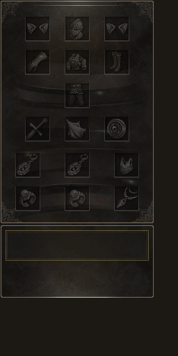

# ChatGpt
arquivos do chat disponíveis 

## Slots de equipamento

Versão atual para teste: [Slots_separados_v5.zip](Slots_separados_v5.zip). Ajusta as três cópias de textura encontradas no L2UI_CH3.u original: Inventory_EquipSlot, MileniumEquipSlot e o fundo com slots incorporados InventoryEquipBg. Não altera posições dos itens nem o interface.u.

Use os dois arquivos de system do ZIP após fazer backup. Consulte [as instruções da V5](Slots_separados_v5_INSTALAR.txt). O XDAT volta à referência do pacote original e dispensa os arquivos SlotFix. As versões anteriores não produziram o resultado esperado no cliente. A V5 ainda precisa de teste no jogo.

Prévia da textura recomposta sobre um fundo opaco para conferência visual (não é uma captura do jogo):

