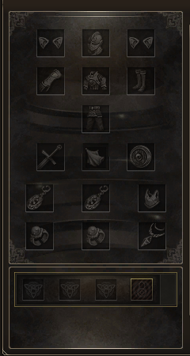

# ChatGpt
arquivos do chat disponíveis 

## Slots de equipamento

**V6 confirmada no jogo e preservada:** [Slots_separados_v6.zip](Slots_separados_v6.zip). Mantém arma, capa e escudo nas três colunas. [Instruções da V6](Slots_separados_v6_INSTALAR.txt).

### Ajuste da capa para teste — V7

[Capa_ajustada_v7.zip](Capa_ajustada_v7.zip) altera apenas os quadrados da capa e sua textura de botão: remove o desenho duplicado do fundo, preserva a moldura e centraliza o ícone com margem transparente de 3 pixels. A textura do botão fica no grupo InventoryWnd, conforme o caminho usado pelo InventoryWnd.uc enviado. Não altera posições dos controles, pixels da arma/escudo, interface.u ou XDAT.

Substitua apenas system/L2UI_CH3.u, guardando a cópia da V6 para voltar se necessário. Mantenha o XDAT da V6. [Instruções da V7](Capa_ajustada_v7_INSTALAR.txt). A V7 ainda precisa de teste no jogo, com a capa vazia e equipada.

Prévia composta com os assets da V7 (não é captura do jogo):

## Auto Equipe — análise e proposta de fonte

[Análise e limitações](Auto_Equipe_ANALISE.txt) · [Fonte proposto e diff](Auto_Equipe_fonte_para_compilar.zip).

O fonte atual só aciona o conjunto por peitoral/corpo inteiro, usa apenas a lista 0 e não filtra classe nem ignora peças já equipadas. A proposta muda o acionamento para o clique, altera o nome para Auto Equipe e acrescenta seleção de família e fila com confirmação.

**Não é um interface.u pronto para instalar.** Falta compilar com o SDK compatível e validar os IDs/metadados dos conjuntos customizados, além de confirmar a classificação mago/fighter desejada. O ZIP contém fonte e diff, com as regras e limitações documentadas. Não altera os pacotes de textura V6/V7, que foram confirmados pelo usuário no jogo.

### Titanium — causa confirmada nos DATs e correção para teste

Nos DATs enviados, os peitorais Titanium Heavy (9301), Light (9306) e Robe (9311) têm set_ids vazio; o peitoral Draconic (6379) tem a lista preenchida. Isso impede a rotina atual de encontrar as peças Titanium por GetSetItemIDList.

[Titanium_cadastro_sets.zip](Titanium_cadastro_sets.zip) altera apenas esses três campos em itemname-e.dat. [Instruções e escopo](Titanium_cadastro_sets_INSTALAR.txt). Os 10.255 registros foram relidos e comparados após codificação/decodificação 413. Precisa de teste no jogo, clicando no peitoral. Não muda o nome da caixa, o filtro de classe ou o acionamento por outras peças. Não substitui interface.u, XDAT nem texturas confirmadas.

### Auto Equipe — DATs para teste

[Auto_Equipe_DATs.zip](Auto_Equipe_DATs.zip) inclui o sysstring-e.dat com a entrada 1907 renomeada para **Auto Equipe** e o itemname-e.dat com o cadastro dos três conjuntos Titanium. [Instruções e escopo](Auto_Equipe_DATs_INSTALAR.txt).

Substitui apenas esses dois DATs, após backup. Mantém texturas V7, XDAT e interface.u. O nome e os cadastros foram validados por releitura e codificação/decodificação 413. Precisam de confirmação no jogo. O clique em qualquer peça e o filtro de classe continuam pendentes da compilação da lógica; a rotina atual ainda aciona pelo peitoral/corpo inteiro.

## TreasureHunt — limpar pedras ao reiniciar o GameServer

[TreasureHunt-limpeza-no-restart.zip](TreasureHunt-limpeza-no-restart.zip) · [Instalação e validação](TreasureHunt-limpeza-no-restart_LEIA-ME.md).

Altera apenas TreasureHuntActiveStore.java e TreasureHuntManager.java: o journal de pedras da execução anterior é limpo na inicialização, sob lock exclusivo. A primeira rodada nova espera o intervalo configurado. Reload preserva as pedras atuais. Histórico de locais e recuperação de equipamentos dos jogadores são mantidos. É necessário substituir as duas classes no projeto e recompilar o GameServer; não contém um JAR pronto.

Compilação com nível Java 8 e testes isolados com as classes reais do mod e simulações do core passaram, incluindo encerramento abrupto de JVM, nova inicialização sem restauração, geração posterior, reload, preservação de histórico/recuperação e lock concorrente. Ainda precisa de validação integrada no GameServer do usuário.

## Mineração — método de início ausente

[MiningInteractionManager-corrigido.zip](MiningInteractionManager-corrigido.zip) · [Classe corrigida](correcoes/mineracao/MiningInteractionManager.java) · [Instruções](correcoes/mineracao/LEIA-ME.md).

Corrige a chamada a `StoneMinerInstance.beginMiningFromInterface`, que não existe nessa versão. O controlador passa a iniciar pela sessão existente (`getTreasureHuntSession().begin(stone)`) e somente após sucesso solicita o ataque. Substitui apenas MiningInteractionManager.java e exige recompilar o GameServer. Não modifica a limpeza das pedras no restart. Compilação e testes isolados passaram; ainda é necessário validar com o core de produção.

## PvP — anúncios de sequência de kills

[L2PcInstance-kill-streak.zip](L2PcInstance-kill-streak.zip) · [Classe completa](correcoes/pvp/L2PcInstance.java) · [Patch](correcoes/pvp/kill-streak.patch) · [Instruções](correcoes/pvp/LEIA-ME.md).

Integra Monster (10), Legendary (15) e WTF (20) ao QuakeSystem existente, no canal crítico do Interlude. Preserva recompensas e outros marcos; os três novos anúncios substituem os anúncios Quake antigos nos mesmos marcos. Corrige o reset da sequência em toda morte confirmada, mesmo antes da flag de kill streak. Requer ALLOW_QUAKE_SYSTEM habilitado e segue as regras de elegibilidade já existentes. Testes isolados dos métodos editados passaram; exige compilar com o core e testar no GameServer.
