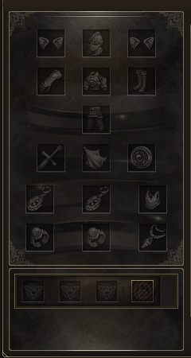

# ChatGpt
arquivos do chat disponíveis 

## Slots de equipamento

Versão atual para teste: [Slots_separados_v6.zip](Slots_separados_v6.zip). Corrige a faixa dos slots em Inventory_BG_Bot, a imagem completa referenciada no fundo da janela do inventário. Essa imagem ainda continha os slots antigos e não tinha sido alterada nas versões anteriores.

O pacote enviado após o teste foi comparado byte a byte e era idêntico à V5; o XDAT de diagnóstico também permaneceu instalado. A V6 muda apenas uma faixa de 150 × 36 pixels da imagem Inventory_BG_Bot, mantendo os demais bytes do pacote iguais à V5. O XDAT incluído desfaz o teste da lixeira. As posições dos itens permanecem iguais.

Consulte [as instruções da V6](Slots_separados_v6_INSTALAR.txt). Ainda é necessária a confirmação no jogo.

Prévia extraída da textura modificada no pacote (não é captura do jogo):

